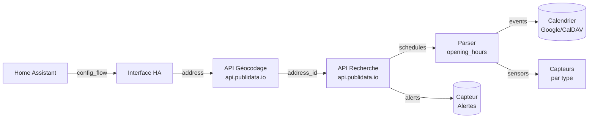
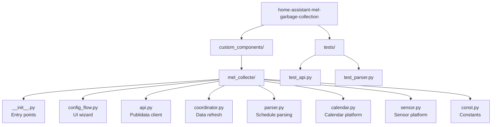

# MEL Collecte des déchets


[](https://github.com/hacs/integration)

[](https://developers.home-assistant.io/docs/integration_quality_scale_index)
[](https://github.com/mmornati/home-assistant-mel-garbage-collection/actions/workflows/validate.yaml)
[](https://codecov.io/gh/mmornati/home-assistant-mel-garbage-collection)

**[Documentation et démonstration en direct](https://mmornati.github.io/home-assistant-mel-garbage-collection/)** · [Vidéo d'une minute](https://mmornati.github.io/home-assistant-mel-garbage-collection/videos/mel-collecte/?lang=fr)

> **Ne ratez plus jamais une collecte !** Ce composant personnalisé récupère automatiquement les jours de passage pour la Métropole Européenne de Lille et les expose dans Home Assistant — calendriers, capteurs et alertes en un seul plugin.

---

## Fonctionnalités

- **Intégration calendrier** : `calendar.collectes_des_dechets` avec toutes les collectes à venir (90 jours)
- **Capteurs intelligents** : Capteur de prochaine collecte avec attributs détaillés, capteurs par type de déchet, et compte à rebours
- **Système d'alertes** : Alertes en temps réel du service de collecte
- **Bilingue** : Localisation complète en français et anglais
- **Automatisations par événements** : Événement natif `mel_collecte.collection_upcoming` pour des automatisations simples
- **Cartes prêtes à l'emploi** : Quatre cartes de tableau de bord livrées avec l'intégration (prochaine collecte, calendrier, guide du tri, déchèteries)
- **Déchèteries et points d'apport** : Les 14 déchèteries de la métropole classées par distance, ouvertes ou fermées à l'instant, les déchèteries mobiles, les bornes à verre et les composteurs de quartier
- **Guide du tri** : Les consignes officielles de la MEL, ce qui va dans chaque bac et ce qui n'y va pas
- **Compatible Trash Card** : Fonctionne avec la carte communautaire Trash Card

---

## Utilisateurs

### Pré-requis

- Home Assistant **2024.6+** (Core, OS ou Supervised)
- Une adresse dans la Métropole Européenne de Lille

### Installation

#### via HACS *(recommandé)*

1. Ajouter ce dépôt comme dépôt personnalisé dans HACS
2. Rechercher **"MEL Collecte des déchets"** et installer
3. Redémarrer Home Assistant

#### Manuelle

1. Copier `custom_components/mel_collecte/` dans `config/custom_components/`
2. Redémarrer Home Assistant

### Configuration

1. **Paramètres → Appareils & services → Ajouter une intégration**
2. Rechercher **"MEL Collecte des déchets"**
3. Saisir l'adresse (ex: `19 rue Gambetta, 59000 Lille`)

L'intégration crée automatiquement les entités ci-dessous.

### Entités créées

| Entité | Type | Description |
|--------|------|-------------|
| `calendar.collectes_des_dechets` | Calendrier | Toutes les collectes à venir (90 jours) |
| `sensor.prochaine_collecte` | Capteur | Prochaine collecte avec attributs détaillés |
| `sensor.jours_avant_prochaine_collecte` | Capteur | Nombre de jours (entier) avant la prochaine collecte |
| `sensor.collecte_<type>` | Capteur | Un capteur par type (`dechets_verts`, `emballages`, …) |
| `sensor.collecte_<type>_dans` | Capteur | Nombre de jours avant la prochaine collecte pour ce type |
| `sensor.alertes_collecte` | Capteur | Alertes actives du service |
| `sensor.decheterie_la_plus_proche` | Capteur | Déchèterie la plus proche : distance, horaires du jour, ouverture |
| `binary_sensor.decheterie_ouverte` | Capteur binaire | Activé quand la déchèterie la plus proche est ouverte |
| `sensor.prochaine_decheterie_mobile` | Capteur | Prochain passage d'une déchèterie mobile près de l'adresse |

**Attributs disponibles** : `types`, `types_friendly`, `couleur` / `couleurs` (couleur du bac : `grey`, `yellow`, `brown`…), `mode`, `debut`, `fin`, `accepted_waste`, `rejected_waste`.

### Cartes de tableau de bord

Quatre cartes sont livrées avec l'intégration : rien d'autre à installer. Dans un tableau de bord, **Ajouter une carte**, puis cherchez « MEL ».

| Carte | Type | Ce qu'elle montre |
|-------|------|-------------------|
| Prochaine collecte | `custom:mel-collecte-card` | Le bac à sortir et quand le sortir, les jours à venir, les informations de la MEL |
| Calendrier | `custom:mel-collecte-calendar-card` | Le mois, aux couleurs des couvercles |
| Guide du tri | `custom:mel-collecte-guide-card` | Recherche d'un déchet dans les consignes officielles, bac par bac |
| Déchèteries et points d'apport | `custom:mel-collecte-places-card` | Les déchèteries les plus proches (ouvertes ou fermées), déchèteries mobiles, bornes à verre, composteurs |

Les cartes trouvent seules l'adresse configurée et suivent le thème de Home Assistant. Démonstration en direct et options : [documentation des cartes](https://mmornati.github.io/home-assistant-mel-garbage-collection/cartes/).

<details>
<summary>Avec la carte communautaire Trash Card</summary>

Le calendrier reste compatible avec [Trash Card](https://github.com/idaho/hassio-trash-card) :

```yaml
type: custom:trash-card
entities:
  - calendar.collectes_des_dechets
next_days: 120
pattern:
  - label: Ordures ménagères
    icon: mdi:trash-can
    color: grey
    pattern: Ordures ménagères résiduelles
    type: waste
  - label: Emballages
    icon: mdi:recycle
    color: yellow
    pattern: Emballages recyclables
    type: recycle
  - label: Biodéchets
    icon: mdi:leaf
    color: brown
    pattern: Déchets verts
    type: organic
  - label: Biodéchets
    icon: mdi:food-apple
    color: brown
    pattern: Biodéchets
    type: organic
  - label: Verre
    icon: mdi:bottle-wine
    color: green
    pattern: Verre
    type: others
  - label: Encombrants
    icon: mdi:sofa
    color: purple
    pattern: Encombrants
    type: others
```


Les couleurs reprennent celles des bacs de la MEL : **gris** pour les ordures ménagères, **jaune** pour les emballages, **marron** pour les biodéchets (publiés par la MEL sous le code `dv`, d'où le motif « Déchets verts »), **vert** pour le verre.

</details>

### Internationalisation

L'intégration est disponible en **français** (par défaut) et en **anglais**. La langue des libellés (noms des capteurs, types de déchets, alertes, événements du calendrier, unités) se choisit dans la configuration de l'intégration :

1. À l'ajout de l'adresse, champ **Langue des libellés** (français par défaut).
2. Ensuite, **Paramètres → Appareils & services → MEL Collecte → Configurer** pour la modifier. L'intégration se recharge automatiquement.

Ce choix est indépendant de la langue de Home Assistant : une instance en anglais affiche donc les collectes en français tant que l'option n'est pas changée.

### Événements et Automatisations

L'intégration déclenche un événement natif `mel_collecte.collection_upcoming` lorsqu'une collecte approche, idéal pour vos automatisations sans nécessiter de modèles (templates) complexes.

* Le délai de déclenchement (par défaut : 24h avant la collecte) est modifiable via le service `mel_collecte.set_collection_offset`.
* Les données de l'événement incluent : `collection_id`, `garbage_types`, `garbage_types_friendly`, `start`, `hours_until`, etc.

---

## Architecture



L'intégration interroge l'API Publidata au démarrage puis **toutes les semaines** (intervalle configurable). Les capteurs recalculent leur état à partir des données en mémoire, sans nouvelle requête.

### Documentation

Le site se construit avec MkDocs : `pip install -r docs/requirements.txt`, puis `mkdocs serve`. Les démonstrations utilisent le fichier des cartes livré avec l'intégration (`custom_components/mel_collecte/frontend/mel-collecte-cards.js`). La vidéo est dans `docs/videos/mel-collecte/` : le texte de la voix off est dans `script.json`, les scènes dans `scenes.js`.

---

## DEVELOPPEURS

### Structure du projet



### Setup local

```bash
# Créer et activer le venv
make install

# Linter et tester
make lint      # ruff + black + mypy
make test      # pytest
make format    # Appliquer black
```

### Commandes utiles

| Commande | Description |
|----------|-------------|
| `make install` | Installe les dépendances |
| `make test` | Exécute les tests pytest |
| `make lint` | Vérifie code (ruff, black, mypy) |
| `make format` | Formate le code avec black |
| `make build` | Génère `mel_collecte.zip` pour HACS |

### APIs Publidata utilisées

1. **Géocodage** — `GET /v2/geocoder?q=<adresse>` → `address_id`
2. **Collectes** — `GET /v2/search?types[]=Platform::Services::WasteCollection&address_id=<id>`
3. **Alertes** — `GET /v2/search?types[]=Alert&states[]=visible&address_id=<id>`
4. **Lieux** — `GET /v2/search?types[]=Facility&facility_types[]=<type>` (déchèteries, déchèteries mobiles, composteurs, bornes à verre)

### Parsing des horaires

Le parser (`parser.py`) convertit les chaînes `opening_hours` (ex: `week 1-52/2 Th 05:50-12:50`) en événements calendario. Chaque créneau devient un événement `RRULE` avec récurrence bimensuelle.

### Contribution

1. Forker le dépôt
2. Créer une branche (`feature/xxx` ou `fix/xxx`)
3. Implémenter avec tests + linting (`make lint`)
4. Ouvrir une Pull Request

---

## FAQ

**Aucune entité créée ?** Vérifiez que l'adresse est dans le périmètre MEL.

**Horaires incorrects ?** Les données viennent de Publidata. Ouvrez une issue si un format est mal parsé.

**Comment forcer un rafraîchissement ?** Vous pouvez appeler le service `mel_collecte.force_refresh` (disponible dans *Outils de développement → Services*) pour rafraîchir les données immédiatement.

---

## Documentation en anglais

Pour la documentation complète en anglais, consultez [`docs/en/user_guide.md`](docs/en/user_guide.md).

---

## Licence

MIT — Contributions bienvenues !